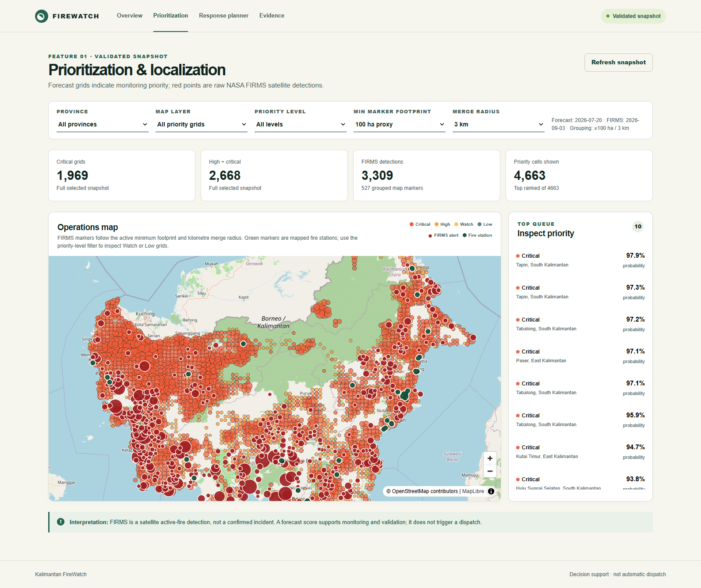
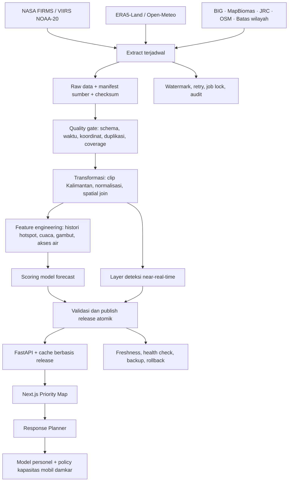

# Kalimantan FireWatch — FIRELINE

FIRELINE adalah dashboard pendukung keputusan untuk monitoring karhutla di lima provinsi Kalimantan Indonesia. Sistem menggabungkan hotspot NASA FIRMS, cuaca, gambut, tutupan lahan, akses air, dan bukti respons insiden untuk menghasilkan prioritas monitoring serta referensi kebutuhan personel dan kapasitas mobil damkar.



## Dua fitur utama

### AI Incident Prioritization & Localization

- Menampilkan deteksi aktif NASA FIRMS VIIRS NOAA-20 dan grid prioritas.
- Mengestimasi probabilitas serta jumlah hotspot pada window mingguan.
- Menggabungkan histori hotspot/FRP, ERA5-Land, gambut BIG, MapBiomas, dan batas administrasi.
- Mengelompokkan deteksi berdekatan melalui minimum sensor footprint dan merge radius.
- Menyediakan filter prioritas Critical, High, Watch, dan Low serta konteks gambut/mineral.
- Memetakan lokasi pos damkar dan referensi rute respons.

### AI Response Planning & Resource Calculator

- Memuat koordinat dan konteks langsung dari pilihan pada peta.
- Mengestimasi personel berdasarkan luas, tanah, tipe api, FWI, akses air, dan benchmark historis.
- Menggunakan model Histogram Gradient Boosting dengan bukti lokal Indonesia dan referensi ICS-209-PLUS.
- Menghitung kapasitas mobil damkar menggunakan `ceil(personel / 6)`.
- Membedakan footprint satelit, skenario luas, laporan lapangan, dan polygon insiden.
- Menghitung luas geodesik polygon GeoJSON di backend.
- Menyediakan sumber kasus historis, konfirmasi operator, dan audit perencanaan.

## Pipeline ETL dan pembaruan near-real-time

Pipeline ETL menjadi jalur pembaruan data FIRELINE: sumber diambil secara terjadwal, divalidasi, ditransformasikan, dibentuk menjadi fitur, kemudian dipublikasikan sebagai release yang konsisten untuk API dan dashboard.

Mode near-real-time mengikuti deteksi yang sudah tersedia dari provider satelit. Forecast merupakan produk mingguan dengan waktu penerbitan, cutoff fitur, dan masa berlaku tersendiri. Keduanya dapat diperbarui secara independen.



### Jadwal pemrosesan

| Jalur | Jadwal awal | Hasil |
|---|---|---|
| FIRMS NOAA-20 NRT | Setiap 30 menit | Deteksi baru, rekonsiliasi revisi, layer peta |
| ERA5-Land | Harian sesuai ketersediaan provider | Cuaca harian dan fitur rolling |
| Open-Meteo / FWI | Setiap 3 jam untuk lokasi terkonfigurasi, serta saat lookup planner | Konteks fire weather |
| Forecast | Window mingguan | Probabilitas, expected hotspot count, prioritas |
| Backup operasional | Harian | Database backup dan manifest checksum |

Cadence tersebut dapat diatur sesuai operasi. Polling tidak mengubah jadwal lintasan satelit atau keterlambatan sumber. Status masing-masing layer tersedia melalui `/api/v1/metadata/status`.

### Aturan data dan model

- Respons provider yang gagal dibedakan dari respons sukses tanpa deteksi.
- Observasi FIRMS direkonsiliasi menggunakan identitas deteksi; perubahan FRP/confidence tidak dianggap insiden baru.
- Data spasial dibatasi ke lima provinsi Kalimantan Indonesia.
- Agregasi hujan ERA5-Land mengikuti total akumulasi pukul 00 UTC untuk hari sebelumnya.
- Model forecast dengan kontrak lag tujuh hari menjaga konsistensi ketersediaan cuaca saat prediksi.
- Label masa depan tidak diperlukan untuk menjalankan scorer.
- Setiap request API menggunakan satu release. Selection peta dari release berbeda mendapat respons 409 agar operator memuat ulang konteks.
- Publish yang gagal mempertahankan release terakhir yang valid.
- Provenance asli/sintetis disimpan sebagai sidecar dan tidak menjadi fitur model. Eksperimen jitter dievaluasi menggunakan kasus asli dengan nested grouped validation.

## Struktur repository

```text
api/                         FastAPI, auth operator, planner, metadata, health
web/                         Next.js / React dashboard
src/firewatch/               ETL, feature engineering, model, FWI, release, audit
scripts/                     Akuisisi, training, scoring, validasi, backup
deploy/                      Dockerfiles, Compose, proxy, konfigurasi contoh
data/raw/                    Sumber satelit, cuaca dan spasial — Git LFS
data/interim/                Hasil transformasi dan fitur reusable — Git LFS
data/processed/              Dataset siap dashboard — Git LFS
models/                      Bobot serving dan kandidat model — Git LFS
reports/                     Hasil evaluasi, quality checks dan provenance
tests/                       Regression tests pipeline/API
docs/                        Arsitektur, metodologi dan runbook
secrets.example.txt          Placeholder credential
```

## Menjalankan secara lokal

### Prasyarat

- Git dan Git LFS.
- Python 3.14 untuk environment yang sesuai dengan artefak model tersimpan.
- Node.js 22 dan npm.
- Windows: gunakan WSL2 untuk dependency geospasial.

### Clone dan ambil data/model

```bash
git clone https://github.com/Ditt-A/Kalimantan-FireWatch.git
cd Kalimantan-FireWatch
git lfs install
git lfs pull
```

File besar disimpan dengan Git LFS. Pastikan bobot model, Parquet, dan raster telah terunduh sebagai file utuh.

### Install dependency

```bash
python3.14 -m venv .venv
source .venv/bin/activate
python -m pip install --upgrade pip
python -m pip install -r requirements-production.txt

cd web
npm ci
cp .env.example .env.local
cd ..
```

### Jalankan backend dan frontend

Terminal backend:

```bash
source .venv/bin/activate
python -m uvicorn api.main:app --host 0.0.0.0 --port 8000
```

Terminal frontend:

```bash
cd web
npm run dev -- --hostname 0.0.0.0 --port 3000
```

Dashboard: [localhost:3000/prioritization](http://localhost:3000/prioritization).

Biarkan `NEXT_PUBLIC_API_BASE_URL` tidak diisi untuk memakai proxy same-origin `/api/v1`. Alamat backend internal dapat diatur melalui `FIREWATCH_INTERNAL_API_BASE_URL` pada server Next.js.

## Deployment Docker

Buat konfigurasi privat dengan access code dan session secret yang digenerate:

```bash
python scripts/configure_deployment.py
```

Isi credential provider di `deploy/.env` untuk menjalankan refresh sumber. Nilai credential tidak dicantumkan di repository.

```bash
docker compose --env-file deploy/.env -f deploy/compose.yaml config --quiet
docker compose --env-file deploy/.env -f deploy/compose.yaml up -d --build
```

Stack berisi PostgreSQL, FastAPI, Next.js standalone, reverse proxy, dan worker ETL. Domain diatur menggunakan `FIREWATCH_DOMAIN`.

Untuk akses publik melalui ngrok:

```bash
docker compose --env-file deploy/.env \
  -f deploy/compose.yaml -f deploy/compose.tunnel.yaml up -d --build
ngrok http 8080
```

HTTPS publik diterminasi oleh ngrok. Gunakan URL HTTPS tersebut untuk session operator production. Monitoring dapat dibaca sebagai viewer; pembuatan rencana dan penulisan observasi memerlukan login operator pada profil production.

Untuk laptop, worker default menjalankan satu job setiap kali. Konfigurasi memori/CPU per layanan berada di Compose.

## Menjalankan ETL

Credential sumber dibaca dari environment:

| Variabel | Kegunaan |
|---|---|
| `FIRMS_MAP_KEY` | NASA FIRMS Area API |
| `CDSAPI_URL`, `CDSAPI_KEY` | Copernicus CDS / ERA5-Land |
| `FIREWATCH_WEATHER_URL`, `FIREWATCH_WEATHER_API_KEY` | Konfigurasi provider cuaca |
| `FIREWATCH_DATABASE_URL` | PostgreSQL operasional |
| `FIREWATCH_OPERATOR_TOKEN`, `FIREWATCH_SESSION_SECRET` | Akses operator dan signed session |
| `FIREWATCH_RELEASE_ROOT` | Lokasi release data yang diaktifkan |

```bash
# Akuisisi, validasi, dan pembaruan layer deteksi.
python scripts/etl_worker.py --job firms

# Refresh ERA5 dan bangun ringkasan harian terkoreksi.
python scripts/etl_worker.py --job era5

# Refresh fire weather untuk lokasi yang dikonfigurasi.
python scripts/etl_worker.py --job weather

# Feature snapshot, scoring model, dan publish forecast.
python scripts/etl_worker.py --job forecast

# Backup database operasional.
python scripts/etl_worker.py --job backup

# Scheduler berulang.
python scripts/etl_worker.py --loop
```

Lokasi cuaca terjadwal diatur di `deploy/weather_locations.json`. Dataset statis diperbarui menurut versi sumbernya. Jalur ingest menyimpan watermark serta manifest yang memuat rentang tanggal, jumlah baris, dan checksum.

## Training, scoring, dan release

Forecast menggunakan dua pipeline: `HistGradientBoostingClassifier` untuk probabilitas dan `HistGradientBoostingRegressor` untuk jumlah hotspot.

```bash
# Bangun data cuaca terkoreksi dari arsip hourly.
python scripts/rebuild_operational_weather.py

# Latih kandidat pada direktori versi baru.
python scripts/forecast_pipeline.py train --model-dir models/candidates/forecast_new_version

# Gunakan kontrak kandidat untuk membuat fitur dan prediksi.
python scripts/forecast_pipeline.py features --week YYYY-MM-DD
python scripts/forecast_pipeline.py score

# Aktifkan release lengkap atau kembalikan release sebelumnya.
python scripts/forecast_pipeline.py publish --release-id forecast-YYYYMMDD
python scripts/forecast_pipeline.py rollback --release-id RELEASE_ID
```

Window forecast dimulai hari Senin. Jalur scoring menggunakan versi model dan definisi fitur yang sama, serta memeriksa kelengkapan input sebelum publikasi.

Eksperimen model personel:

```bash
python scripts/evaluate_personnel_grouped.py
python scripts/train_personnel_jitter_candidate.py
```

Hasil evaluasi dan bobot kandidat disimpan terpisah dari bobot serving. Bukti sumber lokal, benchmark AS, dan provenance data dapat ditelusuri melalui `reports/` dan halaman Evidence.

## Pemeriksaan layanan

| Endpoint | Fungsi |
|---|---|
| `GET /health` | Liveness API |
| `GET /ready` | Kesiapan konfigurasi, database, data dan model |
| `GET /api/v1/metadata/status` | Freshness per layer, release dan status ETL |
| `GET /api/v1/priority/grid` | Grid prioritas |
| `GET /api/v1/planner-context` | Autofill konteks perencanaan |
| `POST /api/v1/response-plans` | Estimasi personel dan kapasitas mobil |
| `POST /api/v1/auth/login` | Session operator |

```bash
python -m pip install -r requirements-dev.txt
OMP_NUM_THREADS=1 OPENBLAS_NUM_THREADS=1 python -m unittest discover -s tests -v
cd web && npm run build
```

Pemeriksaan stack Docker dapat dijalankan dengan `python scripts/check_docker_stack.py`. Pemeriksaan tersebut menggunakan stack dan database fixture terpisah, termasuk uji backup–restore.

## Interpretasi hasil

Deteksi FIRMS adalah observasi panas satelit. Footprint piksel, luas grid forecast, dan perimeter insiden mempunyai arti berbeda. Kebutuhan personel dan kapasitas kendaraan merupakan referensi perencanaan yang diverifikasi operator berdasarkan kondisi lokasi, luas aktual, akses air/jalan, serta kesiapan kru dan armada.

Dokumentasi teknis: [ETL architecture](docs/PRODUCTION_ETL_PLAN.md), [operational runbook](docs/PRODUCTION_RUNBOOK.md), serta laporan pada `reports/`.

API key, access code, token ngrok, database runtime, virtual environment, dependency terpasang, dan cache build dikecualikan dari Git. Gunakan file contoh untuk mengatur credential pada environment masing-masing.
